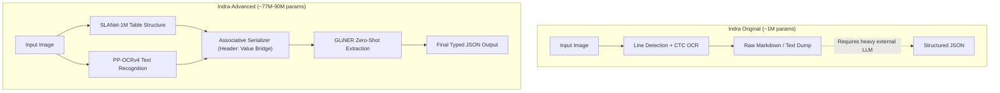

# Indra-Advanced

A lightweight CPU document intelligence pipeline combining table structure recognition, OCR, relational serialization, and zero-shot schema extraction into typed JSON.

## Comparison: Indra Original vs Indra-Advanced

### Architecture Flow



### Feature Comparison

| Capability | Indra Original | Indra-Advanced |
| :--- | :--- | :--- |
| Primary Role | OCR and text line detection | End-to-end schema information extraction |
| Recognition Core Size | ~1 million parameters | ~77M to 90M parameters |
| Output Format | Plain Markdown and line boxes | Typed JSON, table rows, and Markdown |
| Schema Extraction | No (requires external LLM) | Yes (direct zero-shot extraction) |
| Relational Serialization | No (line clustering) | Yes (Header-to-Value preservation) |
| Complex Stamp / Fine-Print | Prone to character drops | High-precision DBNet + CRNN |
| Target Runtime | CPU | CPU |

## Quickstart

### Installation

```bash
python -m venv .venv
source .venv/bin/activate  # On Windows: .\.venv\Scripts\activate
pip install -r requirements.txt
```

### Usage

```python
from indra_advanced import IndraAdvancedPipeline
from indra_advanced.schemas import INVOICE_SCHEMA

pipeline = IndraAdvancedPipeline()
result = pipeline.process("document.png", schema=INVOICE_SCHEMA)

print(result.structured_json)
```

### Web UI & API

```bash
uvicorn indra_advanced.server:app --host 0.0.0.0 --port 8000
```
