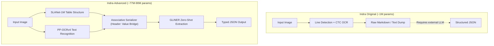

# Indra-Advanced

A lightweight document intelligence pipeline that combines table structure recognition, OCR, associative serialization, and zero-shot schema extraction.

## Architecture Comparison



## Feature Comparison

| Capability | Indra Original | Indra-Advanced |
| :--- | :--- | :--- |
| Primary Role | OCR and line detection | End-to-end schema extraction |
| Core Parameter Size | ~1M parameters | ~77M to 90M parameters |
| Output Format | Plain Markdown line dump | Typed JSON, table rows, and Markdown |
| Schema Extraction | No (requires external LLM) | Yes (direct zero-shot extraction) |
| Relational Serialization | No (line clustering) | Yes (Header-to-Value preservation) |
| Multi-Page Books | External loop required | Native multi-page navigation via PDFium |
| Fine-Print / Stamp OCR | Prone to character drops | High-precision DBNet + CRNN |

## Usage

```python
from indra_advanced import IndraAdvancedPipeline
from indra_advanced.schemas import INVOICE_SCHEMA

pipeline = IndraAdvancedPipeline()
result = pipeline.process("document.png", schema=INVOICE_SCHEMA)

print(result.structured_json)
```
